<div align="center">





</div>

```yaml
apiVersion: people/v1
kind: Engineer
metadata:
  name: kamil-kolmasiak
  labels:
    role: devops-cloud-engineer
    location: krakow-poland
    status: open-to-work
spec:
  experience: 8y IT Infrastructure & Operations   # incidents, RCA, migrations, IAM
  stack:
    cloud: [aws-ec2, s3, rds, iam, cloudfront]
    iac: [terraform, ansible]
    kubernetes: [k3s, kustomize, helm, argo-cd, gateway-api]
    ci-cd: [github-actions, azure-pipelines, trivy]
    observability: [prometheus, grafana, loki, alloy, alertmanager, cloudwatch]
    databases: [postgresql, cloudnative-pg, flyway]
    security: [rbac, network-policies, sealed-secrets, tailscale]
    ai: [claude-code, claude-api, mcp]
  languages: [bash, python, sql]
  containers:
    - name: multiplayer-game-platform
      image: k3s + argo-cd + cloudnative-pg      # gitops, backups, runbooks
    - name: tripin.pl
      image: aws + terraform + ansible           # live web product
    - name: moonlight
      image: python + opencv + claude-code       # ~1,200 tests behind CI gates
  contact:
    linkedin: linkedin.com/in/kamil-kolmasiak-6aa683132
    email: kamil.kolmasiak@gmail.com
```

<div align="center">

[](https://www.linkedin.com/in/kamil-kolmasiak-6aa683132)
[](mailto:kamil.kolmasiak@gmail.com)

</div>
